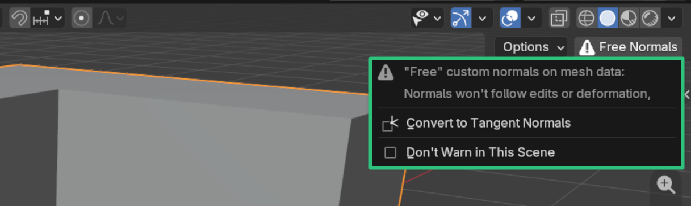
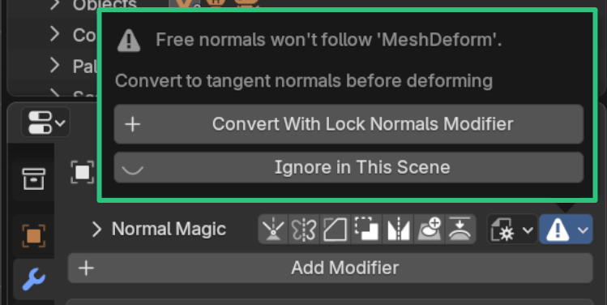

# Free Normals Warnings

Blender can store custom normals in two ways:

- **Free.** Fast, and what normalMagic modifiers create by default. These **don't follow** later edits or deformation.
- **Tangent.** Slower, but they follow edits and deformation.

There are two main areas where "Free" normals can cause problems:

1. When they exist on the source mesh data, edits will break the normals.
2. When stacking deforming modifiers after normalMagic ones, the normals won't follow the deformations.

The add-on shows a warning for both cases.

!!! info "Applying Modifiers"
    When applying modifiers from the [Modifier References](./modifier_references.md#apply-delete) panel, "Free" normals are converted to tangent normals automatically.

## Source Normals Warning

When the mesh data of selected objects stores "Free" custom normals, a ":fontawesome-solid-warning: **Free Normals**" menu shows at the end of the tool header, in Edit Mode and Object Mode.

- **Convert to Tangent Normals.** (Recommended) Converts the stored normals to tangent normals.
- **Don't Warn in This Scene.** Hide this warning for the current scene.

To hide this warning everywhere, turn off "Warn About Free Source Normals" in [preferences](./preferences.md#normal-warnings).

## Deform Warning

When "Free" normals reach a deforming modifier (e.g. Armature, Lattice, Simple Deform), a ":fontawesome-solid-warning:" dropdown shows at the end of the [modifier header](./modifier_header.md#warnings).

- **Convert With Lock Normals Modifier.** Adds a [Lock Normals](../normal_tools/lock_normals.md) modifier set to "Tangent" before the deforming modifier.
- **Ignore in This Scene.** Hide this warning for the current scene.

!!! tip "Turning Warnings Back On"
    Warnings hidden for a scene can be turned back on in [preferences](./preferences.md#normal-warnings).
