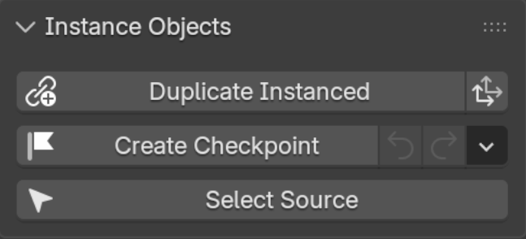
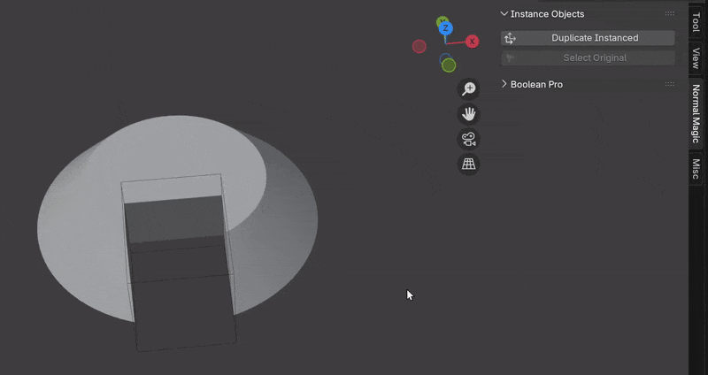

# Instance Objects

These tools make it easier to use the [Instance Object](../other_tools/instance_object.md) modifier.

## Duplicate Instanced

This operator that acts like Blender's built-in [Duplicate Linked](https://docs.blender.org/manual/en/latest/scene_layout/object/editing/duplicate_linked.html) but also copies the results of all modifiers:

The **instanced** object can be duplicated with any existing methods e.g. ++'Shift'+'D'++ and will keep the same behavior.

Using this operator on an object that already is using a "Instance Object" as it's last modifier will instance the original object to keep things simple.

Toggle the :material-arrow-all: button next to the operator to start moving the instance straight away.

### What it does

For each selected object:

1. Create a new object with the same mesh data as selected object. This is so you can still enter "Edit Mode" on the instance.
2. Add [Instance Object](../other_tools/instance_object.md) modifier and specify selected object.
3. Select instance object and deselect original.

## Checkpoints

Checkpoints are an alternative to large modifier stacks. Create a checkpoint to "freeze" the result of an object's modifiers into an instance, then keep adding modifiers to the checkpoint. Changing modifiers on the checkpoint doesn't re-evaluate the source object's modifiers, so they stay interactive, and you can always step back to change earlier modifiers.

- :material-flag-outline: **Create Checkpoint.** Instance the selected object(s) as a checkpoint named `<source>_checkpoint_<n>`, with an Instance Object modifier named `<source> checkpoint <n>`. Creating a checkpoint from the last checkpoint continues the chain.
- :material-arrow-left: / :material-arrow-right: **Previous/Next.** Step along the chain from the active object. **Previous** goes to the object the checkpoint instances, back to the original source. **Next** goes to the checkpoint made from it. The object you step to is shown and selected, and the current one is hidden (in the viewport and in renders). Needs a selected mesh or curve. Checkpoints hidden by their collection are revealed through the [Hidden Collections](./modifier_references.md#hidden-collections) dialog.
- **Checkpoint Settings** (dropdown):
    - **Parent to Source.** (Off by default) Parent checkpoint objects to the original source object.
    - **Hide Source.** (On by default) Hide the object a checkpoint is made from, in the viewport and in renders.

### Branches

Creating a checkpoint from an object that already has one after it (e.g. stepping back with **Previous** and creating a new checkpoint) starts a **branch**. A dialog asks you to confirm first. Duplicating a checkpoint with ++"Shift"+"D"++ also creates a branch.

When there is more than one branch, **Next** goes to the newest checkpoint.

### Collapsing Checkpoints

A checkpoint is part of the chain while its Instance Object modifier is first in the stack. If you apply that modifier (e.g. with [Collapse to Selected](./modifier_references.md#apply-delete)), the checkpoint becomes a normal object: **Previous** and **Select Source** no longer go back past it, and checkpoints made from it start a new chain.

## Select Source

Selects the source object(s) being instanced by selected object(s). This is useful when you wish to edit the mesh or change modifiers on the original object.

- On a checkpoint, selects the original source object of the chain.
- **Show Source.** (On by default) If the source object is hidden, it is unhidden. If it's hidden by its collection, the [Hidden Collections](./modifier_references.md#hidden-collections) dialog asks before turning the collection on.
