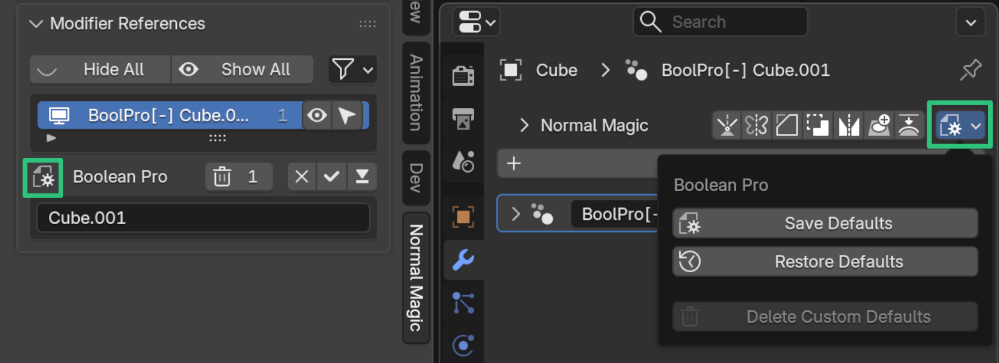

# Modifier Defaults

You can save default settings for any modifier added via normalMagic operators.

!!! note "Note"
    This will have no effect on modifiers added through the "Add Modifier" menu.

This is achieved through the **Modifier Defaults** menu, available in the [Modifier Header](../add-on/modifier_header.md) bar and the [Modifier References](./modifier_references.md) panel.

## Options

The menu acts on the active (highlighted) modifier:

- **Save Defaults.** Save all settings from the active modifier and use them as the default. In Blender 5.2+ output attribute names are saved too.
- **Restore Defaults.** Set the active modifier's settings back to your saved defaults, or the built-in defaults if none are saved. Object and collection inputs (and Boolean Pro's operation) are kept.
- **Delete Custom Defaults.** Delete your saved defaults for this modifier. Modifiers added with normalMagic will use the built-in defaults again.

!!! info "Kept Through Updates"
    Saved defaults are stored in the add-on's user folder and are kept when you update the add-on. Uninstalling the add-on removes them.
