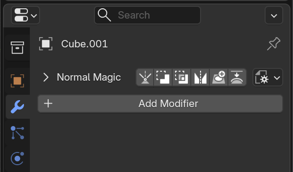

# Modifier Header

The optional modifier header bar gives quick access to several normalMagic features without using the sidebar. From left to right:

### Expand Arrow

Show the [Modifier References](./modifier_references.md) panel below.

### Operators Bar

A row of buttons for quickly adding normalMagic operators. These can configured in [preferences](./preferences.md#ui-preferences). 

All of these allow for multi-object selection, for assigning cutters for example. Modifiers added from the header bar only collapse their object inputs panel (when objects are assigned) so the rest of the settings stay visible.

Available buttons:

- [Mark Sharp](../other_tools/mark_sharp.md)
- [Symmetrize](../mesh_tools/symmetrize.md)
- [Solidify Pro](../mesh_tools/solidify_pro.md)
- **Bevel.** Adds Blender's Bevel modifier with **Face Strength** set to "All", followed by a [Repair Bevel Normals](../normal_tools/repair_bevel_normals.md) modifier.
- [Smooth Normals](../normal_tools/smooth_normals.md)
- [Face Weighted Normals](../normal_tools/face_weighted_normals.md)
- [Normal Transfer](../normal_tools/normal_transfer.md). Works like [Project to Surface](./surface_integration.md#project-to-surface): other selected objects get a Normal Transfer modifier that transfers normals from the active object.
- [Boolean Pro](./boolean_pro.md#operations): Difference, Union, Intersect, Slice and [Split](./boolean_pro.md#split)
- [Boolean Extrude](../mesh_tools/boolean_extrude.md), [Boolean Trim](../mesh_tools/boolean_trim.md) and [Cut Groove](../mesh_tools/cut_groove.md)
- [Surface Insert](./surface_integration.md#surface-insert) and [Project to Surface](./surface_integration.md#project-to-surface)

### Modifier Defaults

Save, restore or delete the default settings for the active modifier. These will be used any time a modifier of the same type is added via the add-on. See [here](./modifier_defaults.md) for more info.

### Warnings

Small dropdowns appear at the end of the header bar when something needs attention:

- :material-information-outline: **Node Updates.** Newer versions of normalMagic modifiers on this object are available. See [Update Existing Scenes](../install.md#update-existing-scenes).
- :fontawesome-solid-warning: **Free Normals.** "Free" custom normals reach a deforming modifier. See [Free Normals Warnings](./free_normals.md#deform-warning).
