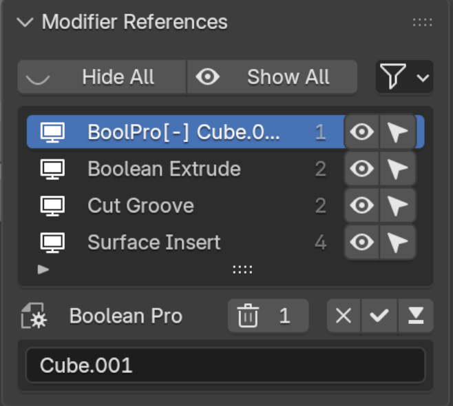
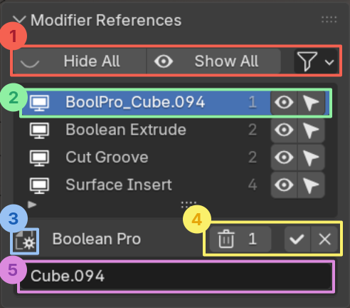

# Modifier References

Use this panel to manage complex non-destructive scenes with many cutters, inserts, or other objects referenced by modifiers.

!!! info "Active Object"
    This panel shows modifiers for the **active object** only i.e. modifiers that show up in Blender's modifiers panel.

{width=512}

Instantly select, show or hide objects that are referenced by the active object's modifiers.

## UI Breakdown

The main list displays the active object's modifiers (see [Filter References](#filter-references)). Selecting a modifier will also select it in the object's modifier panel and display it's individual references below.

- 

- 

    **1.** **Hide/Show All:** Hide or show all referenced objects for the active object. [Filter](#filter-references) the modifier list below.

    **2.**  **Modifier List:** Each entry here is a modifier on the active object:  
        - **Toggle** modifier  
        - **Show/Hide** referenced objects  
        - **Select/Deselect** referenced objects

    **3.** **Modifier Defaults:** Set the default settings for the highlighted modifier. See [here](../add-on/modifier_defaults.md) for more information.
    
    **4.** **Apply/Remove Modifier:** Apply or remove the highlighted modifier with an option to delete referenced objects. See [Apply & Delete](#apply-delete).

    **5.** **Referenced Objects:** Displays referenced objects, you can rename them here.

## Filter References

The filter dropdown next to **Hide/Show All** chooses which modifiers show in the list:

- **Without References.** (On by default) Show modifiers that don't reference any objects.
- **Checkpoint Source.** (Off by default) Show a [checkpoint's](./instance_objects.md#checkpoints) Instance Object modifier, which references the previous checkpoint. Off by default so **Show All** doesn't unhide the previous checkpoint.
- **Instance Source.** (On by default) Show an [instance's](./instance_objects.md) Instance Object modifier, which references the object it instances.

Modifiers hidden from the list are skipped by **Hide/Show All** and **Select All**.

## Hidden Collections

Showing or selecting referenced objects also reveals objects that are hidden because of their collection. When this is needed, a **Hidden Collections** dialog first lists each object and its hidden collections (hidden, excluded, or "Disable in Viewports"). Press ++"Force Show"++ to turn those collections back on.

!!! warning
    Force Show turns on the whole collection, including everything in it. Turning off a collection's "Disable in Viewports" affects every view layer and scene.

The same dialog is used by [Select Source](./instance_objects.md#select-source) and checkpoint [Previous/Next](./instance_objects.md#checkpoints).

## Apply & Delete

These buttons act on the highlighted modifier:

- :material-trash-can-outline: **Delete Objects on Modifier Apply:** Toggle whether referenced objects are deleted when the modifier is applied or removed. The number shows how many objects are referenced.
- :material-close: **Delete Modifier:** Remove the modifier.
- :material-check: **Apply Single Modifier:** Apply only this modifier.
- :material-arrow-collapse-down: **Collapse to Selected:** Apply all modifiers from the top of the stack down to and including this one.

When applying modifiers:

- "Free" custom normals are converted to "Tangent" normals (**Create Tangent Normals**, on by default) so they keep following later edits and deformation. See [Free Normals Warnings](./free_normals.md).
- Meshes shared with other objects (instances, linked duplicates) are made single user, so other objects aren't affected.

### Shared References

If an object that would be deleted is also used by another modifier, a **Shared References** dialog lists those objects and the modifiers using them. Choose to:

- **Keep shared objects:** (Default) Only delete objects no other modifier uses.
- **Delete anyway:** Delete all referenced objects.

