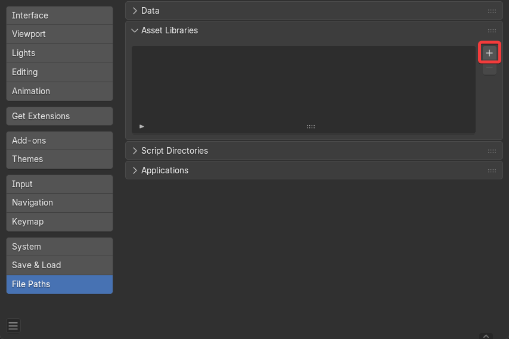
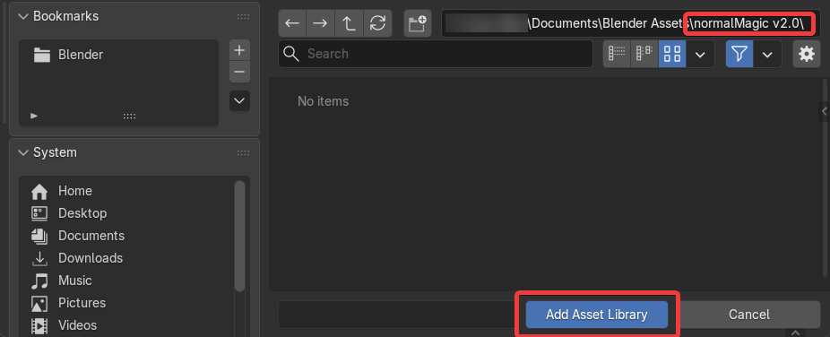
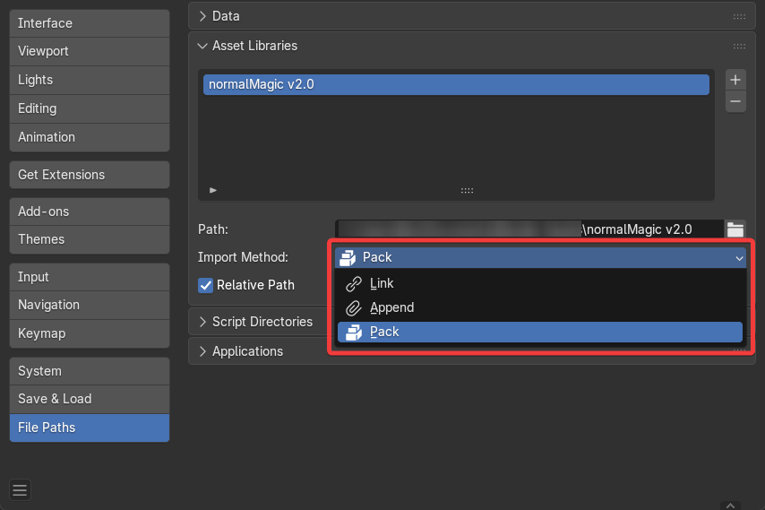
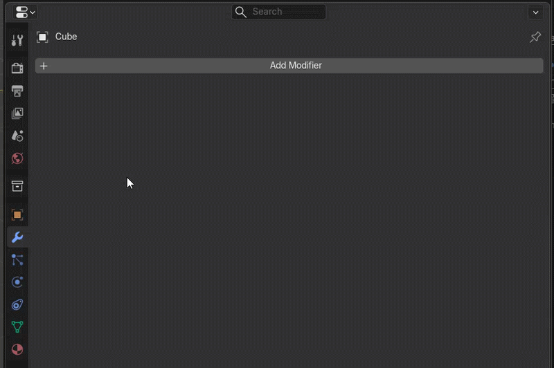
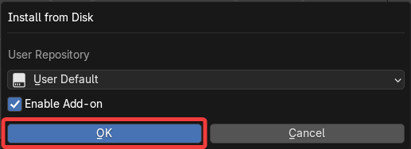
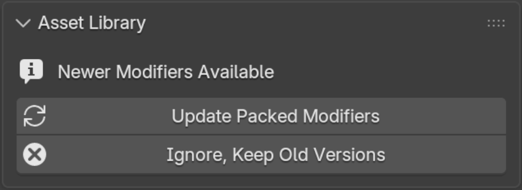
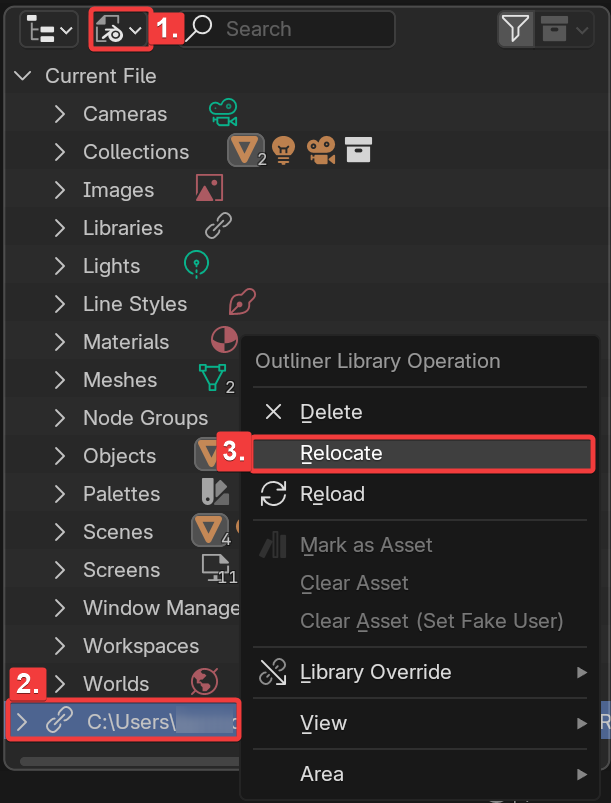
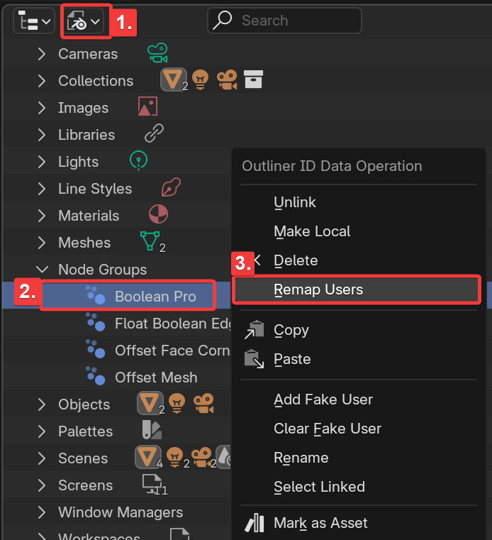

# Install

To install normalMagic please see the relevant section for your version:

[**Base Version**](#base-version-asset-library) is installed as an **asset library.**

[**Pro Version**](#pro-version-add-on) is installed as an **add-on** (that is packaged with the asset library).

## Base Version (Asset Library)

<iframe width="900" height="390" src="https://www.youtube.com/embed/JhmOyhYI4zM?si=6bum43lpGP8y-p-x&amp;start=101" title="YouTube video player" frameborder="0" allow="accelerometer; autoplay; clipboard-write; encrypted-media; gyroscope; picture-in-picture; web-share" referrerpolicy="strict-origin-when-cross-origin" allowfullscreen></iframe>

The Base version of normalMagic is installed as an **asset library**, not an add-on.

!!! tip "TLDR"
    Download the **.zip**, extract to a folder, add the folder as an asset library.
    
    For more detailed instructions see below.

    !!! info "For more information on asset libraries you can check Blender's [Official Documentation](https://docs.blender.org/manual/en/dev/files/asset_libraries/introduction.html#introduction)"

### First Time Install

1. Download latest .zip file for the closest Blender version (*normalMagic 4.5 v1.0.blend*).
2. Unzip/extract to a folder in your desired location.
3. Open Blender and go to **Edit/Preferences/Asset Libraries.**
4. Click ++"\+"++ Add Asset Library.  
    
5. Navigate to the unzipped folder and press **Add Asset Library**.  
    
6. You should now see "normalMagic" in your asset libraries.  
**Optional**: Here you can choose how the data is imported by default. **Link** keeps scenes up to date with the installed library and reduces file sizes, but files need the library to open. **Pack** and **Append** store a copy in each file, so files work anywhere but keep their version until you [update them](#update-existing-scenes). See the [Official Documentation](https://docs.blender.org/manual/en/latest/editors/asset_browser.html#import-settings) for more information. 

normalMagic should now be installed. Modifiers will now show up under the **Add Modifier** menu:

### Update Asset Library

To update to a newer version of the normalMagic asset library:

1. Remove existing asset library under **Edit/Preferences/File Paths/Asset Libraries.**
2. Repeat [install instructions](#first-time-install) to add new version.

Alternatively you could replace the files in the existing library with the newer ones.

----

## Pro Version (Add-on)

<iframe width="900" height="390" src="https://www.youtube.com/embed/0sf4ywieXwA?si=OkeINCXTq5aEIvTH&amp;start=373" title="YouTube video player" frameborder="0" allow="accelerometer; autoplay; clipboard-write; encrypted-media; gyroscope; picture-in-picture; web-share" referrerpolicy="strict-origin-when-cross-origin" allowfullscreen></iframe>

The Pro version of normalMagic is installed as an add-on. The asset library is now packaged with the add-on and can be set up with a single click.

!!! tip "TLDR"
    - Download the add-on **.zip** file and drag it into Blender's viewport.
    - The asset library is set up automatically.

!!! warning "Remove Existing Asset Libraries"
    Updating from 1.x versions will require removing the existing asset library from **Edit/Preference/File Paths/Asset Libraries**.
    

### Install Add-on
To install/update the add-on simply:

1. Download the latest "addon" .zip file.
2. Drag the .zip file into Blender and press ++"OK"++. 
3. The bundled asset library is set up automatically. If it isn't found, press ++"Install Asset Library"++ in the sidebar, or ++"Open Preferences"++ to use an asset library from elsewhere (See the next section).

!!! tip "Other normalMagic Libraries"
    If you have other normalMagic asset libraries installed (e.g. the Base version or a 1.x version), they are listed in the add-on's [preferences](./add-on/preferences.md#other-normalmagic-libraries) where you can disable or remove them.

### Custom Asset Library Location
It is advised to use the asset library bundled with the add-on to keep them in sync. However, if you want your asset library imported from another location follow the instructions below.

1. Add the asset library through **Edit/Preferences/File Paths/Asset Libraries** (see [Base Version](#base-version-asset-library) instructions).
2. In the add-on's [preferences](./add-on/preferences.md#asset-library), set **Location** to **Custom** and choose your library from the list.

!!! warning "Library Version"
    A custom library won't update with the add-on. The add-on will warn you if the library's version doesn't match.

### Update Add-on

1. Drag the new .zip file into Blender, this will update the existing version.
2. The bundled asset library updates with the add-on. If you are using a custom asset library location this will need updating manually.

Your preferences and [Modifier Defaults](./add-on/modifier_defaults.md) are kept when updating.

---- 

## Update Existing Scenes
Modifiers that already exist in scenes might need updating depending on your asset library setup.

### Pro Add-on

The add-on detects normalMagic modifiers made with an older version.

{width=512}

When opening an older file a **Newer Modifiers Available** message shows at the top of the sidebar panel, and an :material-information-outline: info dropdown shows in the [modifier header](./add-on/modifier_header.md#warnings).

- **Update Packed Modifiers.** Replace old modifiers with the versions from the current asset library. With the **Linked** [import method](./add-on/preferences.md#asset-library) you can choose **Update & Link** or **Update Packed** instead.
- **Ignore, Keep Old Versions.** Keep the old versions in this file. You'll be asked again when a newer version of normalMagic is installed.

Modifier settings are kept when updating. Updating can be undone with ++"Ctrl"+"Z"++.

!!! warning "Breaking Changes"
    If a modifier has changed in a way that may affect how existing scenes look, a **Breaking Changes** dialog lists those modifiers before updating. Untick any you want to keep at their old version.

To turn off update checks, disable **Offer to Update Existing Modifiers** in the [preferences](./add-on/preferences.md#asset-library).

### Base Version

For the Base version (asset library only), update modifiers manually.

#### Linked Library
If **library is set to "Link"**, modifiers update automatically when the new version is installed in the same location.

If the new version is installed somewhere else, point existing scenes to it:

1. Go to the outliner and change the view to "Blend File".
2. Locate the normalMagic file.
3. Right Click/Relocate.
4. Select .blend file in the current asset library path.

{ width=512 }

#### Packed/Appended Library

Update modifiers in existing scenes if **library is set to "Pack" or "Append"**. These store a copy in each file, which doesn't update when the library does:

1. Add new version of modifier somewhere in your scene.
2. Go to the outliner and change the view to "Blend File".
3. Find the old modifier:
    - **Appended:** under "Node Groups".
    - **Packed:** under the normalMagic library it was packed from (not under "Node Groups").
4. Right Click/Remap Users.
5. Select the newer version:
    - **Appended:** most likely called ".001".
    - **Packed:** same name, from the newer normalMagic library.

{ width=512 }