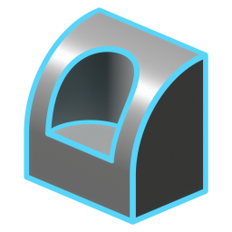
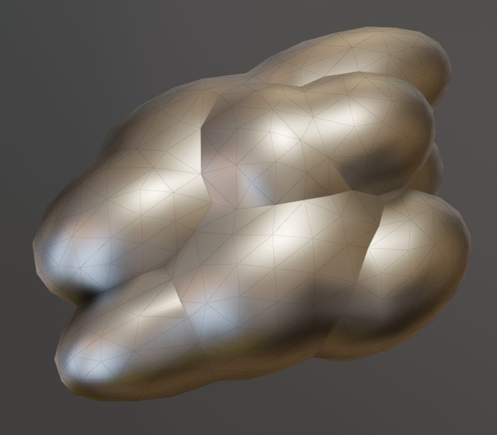
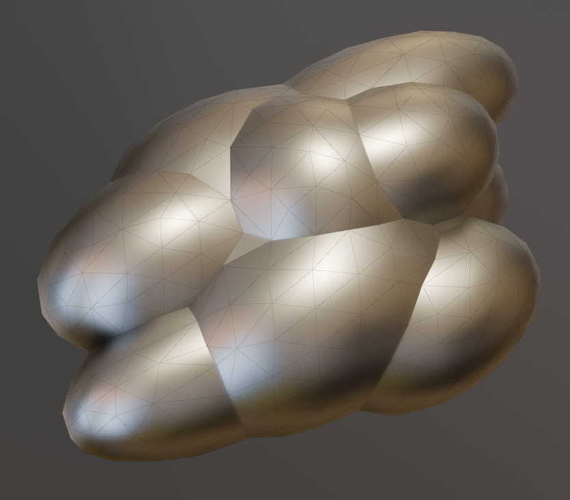

# Mark Sharp

{ width=128 }

Mark Sharp will mark edges as sharp based on edge angle. This is similar to Blender's [Smooth By Angle](https://docs.blender.org/manual/en/latest/modeling/geometry_nodes/normals/smooth_by_angle.html) modifier but with extra options. There are options to remove and/or add custom normals.

-  
**Smooth By Angle**  
One angle for all edges
- 
**Mark Sharp**  
Separate angles for convex/concave edges

## Options

- **Keep Existing:** Keep edges already marked as sharp.
- **Angle Type:** 
    - **Absolute Angle:** Use a single angle regardless off convexity. This behaves like "Smooth By Angle".
    - **Convex / Concave:** Specify different angles depending whether edges are convex or concave.
    - **Edge Creases:** Mark creased edges as sharp.
    - **Custom Normal Seams:** Detect seams in custom normals and mark as sharp.
- **Remove Custom Normals:** Will remove any custom normals from geometry and use default normal calculation from sharp edges.

## Shade Auto Smooth (First)

!!! tip "Pro Add-on"
    This operator is part of the [normalMagic Add-on](../add-on/index.md).

Found in the object right-click menu, above **Shade Smooth**. It can be hidden in the add-on's [preferences](../add-on/preferences.md#auto-smooth).

Adds the [Preferred Smooth Modifier](../add-on/preferences.md#auto-smooth) (**Mark Sharp** or **Smooth by Angle**) at the **start** of the modifier stack, so shading is based on the original mesh before other modifiers add new edges. On a [checkpoint](../add-on/instance_objects.md#checkpoints) it is added after the Instance Object modifier.

If the object already has one, it is moved to the start instead (Blender's "Smooth by Angle" is unpinned from the end of the stack).

- **Angle.** Maximum face angle for smooth edges. Only applies to newly added modifiers.
